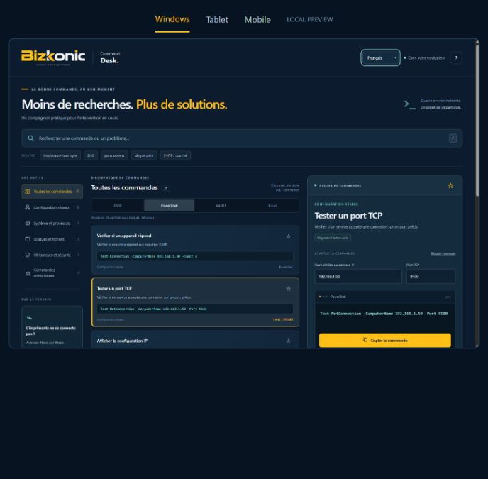

# Bizkonic Command Desk

Browser-local command lookup and parameter builder by Alireza Rajabi.
Supports English, French and Farsi. Every new load, reload or
return after leaving starts in English. Language stays in memory for internal
navigation only; it is never remembered in localStorage, cookies or the URL.

[Open the app](https://alirezarajabi-dev.github.io/command-desk/)

Find the right command, build it for your environment and understand the next step.
No accounts, installs or backend required. An independent portfolio project;
the main Bizkonic app and Field Report are maintained separately.



## Use locally

Requires Node.js 20 or newer, with no dependencies to install.

```sh
npm start
```

Open http://127.0.0.1:8864/ . Review frames:
- Windows layout: /review/desktop (1366 × 900 CSS pixels)
- Mobile layout: /review/mobile (390 × 844 CSS pixels)
- Tablet layout: /review/tablet (768 × 1024 CSS pixels)

These are browser viewport simulations, not physical-device or OS certification.
The frame scales to fit the review panel; use the ordinary root page for normal-size use.

## Features

- 25 practical tasks with separate Windows CMD, Windows PowerShell, macOS and Linux variants.
- Four categories, symptom keywords, typo-tolerant search and result pagination.
- Host/IP, port, PID, path and Wi-Fi profile parameters with validation.
- Continuous-ping, port filtering and optional force-termination variants.
- Copy feedback, side-by-side comparison and saved command IDs.
- A five-step printer-network troubleshooting guide with editable IP and print port.
- SMTP desk: opt-in domain MX lookup, clearly separate sending-provider
  references, and a guide for reading the printer's actual SMTP configuration.
- Purpose, interpretation, prerequisites, local help and external references.
- Original owner-supplied Bizkonic logo, gold/navy/teal tokens, system/Segoe UI typography,
  licensed local Caveat accent font. No substituted or generated logo.

The app does not execute commands, scan devices, collect terminal output or store
parameter values. The SMTP desk makes a DNS-only HTTPS request to Google Public
DNS when Look up is chosen; it strips the email username and sends only the domain
as the query. Google also receives normal connection information. Lookup results and
printer entries are not saved. It never reads printer settings automatically or asks
for device/email credentials. Saved IDs and the chosen environment use localStorage.
Copy uses the Clipboard API with a selectable-text fallback. External references open
only when chosen. Inspect a generated command before running it in the intended shell.

## Checks

```sh
npm test
```

Checks cover malformed/injected parameters, all command variants, shell-specific
flags, matching/filtering and the guided workflow. No example command is run.
Actual command availability depends on installed OS versions, modules and packages;
Linux resolved/firewall/NetworkManager prerequisites and macOS limitations are noted.
Browser layout/copy checks do not verify execution on macOS or Linux.

## Files

`index.html` is the entry point; `styles.css`, `app.js` and `commands.js` separate
presentation, interactions and command data. `mail-model.js` / `mail-ui.js` handle the SMTP desk; `i18n.js` and the translation modules handle the three languages. `server.mjs` serves only preview assets
on loopback. No Tailwind CDN, framework, tracking, login, paid API or build process.
Font licenses: assets/caveat-OFL.txt and assets/vazirmatn-OFL.txt. Brand artwork belongs to Alireza Rajabi and is
not a general-purpose open-source asset. No open-source license is granted for
the original app or brand artwork. The third-party font retains its included OFL license.

## Hosting

GitHub Pages serves this repository's `main` branch from the root folder.
All application assets use relative URLs, so the app works under `/command-desk/`.
No custom domain, secrets, environment variables or build step are required.
To update it, test changes locally, commit the source, and check the Pages deployment.

Content review date: 28 October 2026. Windows references use Microsoft Learn;
macOS network references use Apple's source/manuals or Terminal guide; Linux
references use tool maintainers' documentation and the man-pages site. The local
manual command is shown for confirming installed-version syntax.
